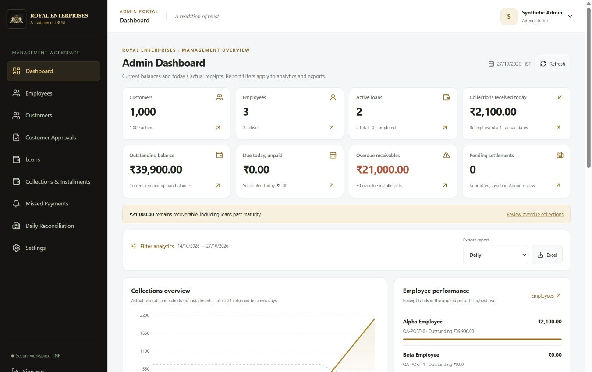
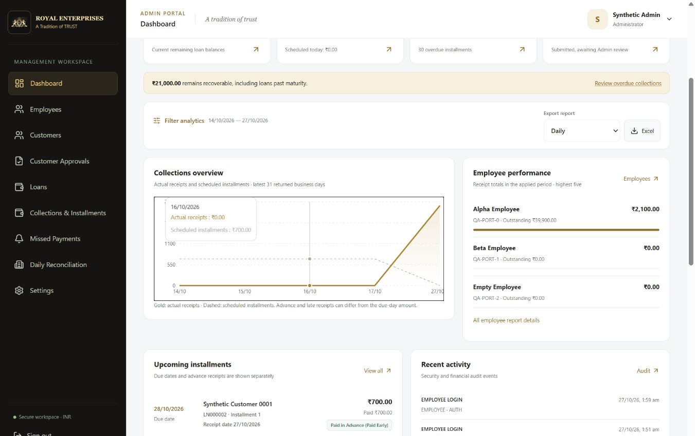
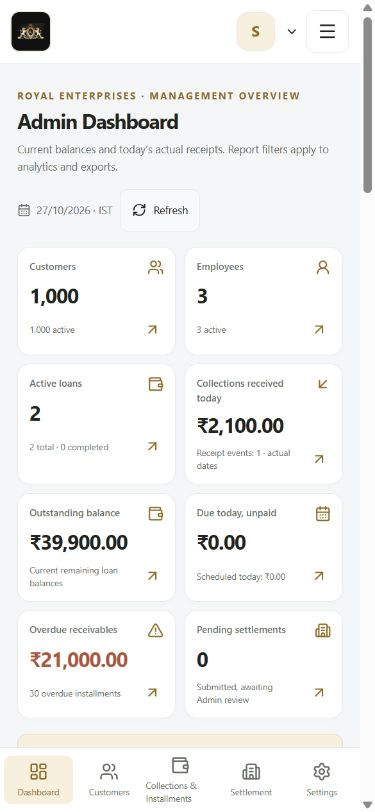
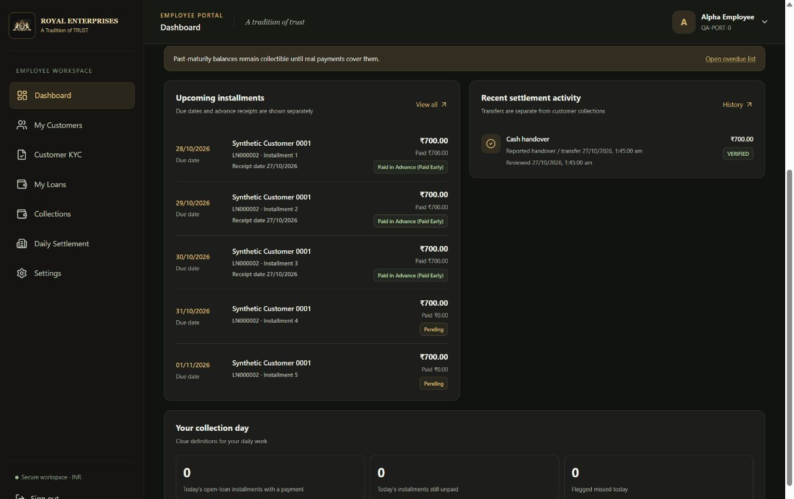
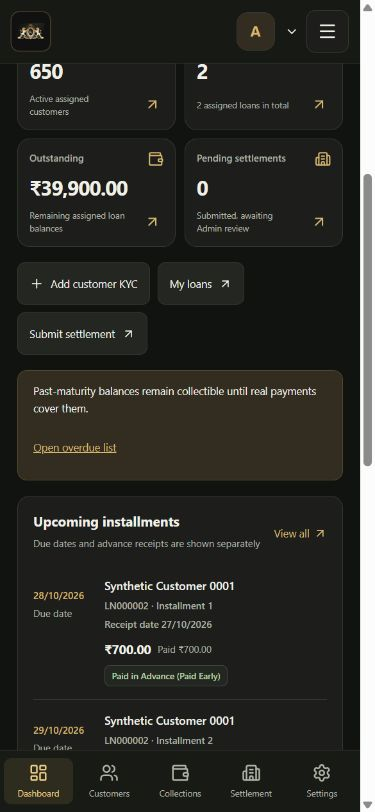

# Royal Enterprises dashboard redesign

## Delivered

The existing React Admin and Employee dashboards were redesigned using the current APIs, original Royal Enterprises logo and existing navigation. No dashboard reference image was visible in the latest message, so the implementation follows the supplied design requirements rather than claiming an exact image match.

**Admin:** white workspace, black/gold sidebar, eight compact KPI cards, a compact report toolbar, actual collections versus scheduled-dues chart, employee performance, upcoming installments, safe audit activity, settlement history and operational detail. Oversized empty charts are replaced with short, honest empty states. The area chart and additional report details remain accessible on demand.

**Employee:** a dark black/gold dashboard and matching header/bottom navigation, seven compact financial/work cards, a prominent Collect Payment action, refresh, KYC/loan/settlement shortcuts, upcoming installments and recent settlement activity. The role-specific dashboard colors are scoped to the dashboard route; other pages retain the employee's saved appearance preference. Saved preferences were not overwritten in the configured database.

## Financial presentation corrections

- Admin KPIs describe company-wide current balances and today's actual receipt events. The existing global KPI endpoint does not implement report filters, so the UI clearly separates the global overview from filtered analytics/exports.
- Actual collection totals are labeled **receipts**, not profit. Outstanding and overdue are current balances. Settlement transfers are never added to collection receipts.
- Today's installment activity uses independent counters on open loans. An installment with a partial payment may also remain unpaid. The former pie chart mixed receipt-event counts with installment counts and could incorrectly imply mutually exclusive statuses; it was replaced with clear counters.
- Reported collection ratios remain available with their existing definition: receipt amount divided by scheduled dues. The API returns zero when there are no scheduled dues; advances can produce a ratio above 100%.
- The daily report returns `date`, not `_id`. Chart dates now use the real report field and chronological order. The chart preview uses the latest 31 returned dates and does not fabricate missing dates or payments.
- Upcoming rows retain customer, loan, installment number, full installment amount, paid amount, due date, actual stored receipt date and backend status. A partially paid installment also shows its remaining amount.
- Settlement reported handover/transfer time and review time are displayed separately using Asia/Kolkata.
- Missing financial data displays an em dash, not a made-up zero. Failed loads have a retry state instead of rendering a null statistics object.

No loan formula, interest rule, schedule, allocation, receipt, custody calculation, settlement review or backend financial service was changed.

## Filters, exports and performance

The default report period is the latest 14 calendar days in Asia/Kolkata. **Filter analytics** exposes date controls; **More filters** retains employee, city, area, loan status and payment-method filters. Employees can be found by name/code and selected through the existing paginated employee API, including inactive employees for historical reporting. Search is debounced and results are bounded to 50; refine the search for more matches.

Filters apply only after **Apply filters**, avoiding a dashboard reload on every keystroke. **Clear filters** restores the all-date report view. Customer/employee/loan balances in the company overview remain global. All seven exports are retained through one selector: Daily, Monthly, Outstanding, Collections, Employees, Customers and Loans.

Area analytics and employee search load when opened. Upcoming installments are server-limited to five rows. Existing report endpoints and permissions were reused. Employee dashboards no longer import the large Settings page to render summary cards. Refresh reloads the relevant dashboard summaries and upcoming records without modifying data.

## Blank chart defect fixed

A shared `.recharts-wrapper { max-width: 100% }` rule constrained the drawing area against an intentional zero-width measuring parent used by Recharts. This caused actual chart SVGs to have zero width despite loaded data. The incorrect inner width cap was removed. Overflow containment remains on the correctly sized outer responsive container.

After the fix, browser QA confirmed visible nonzero SVG widths, rendered curves, real date labels, tooltip interaction and no page overflow at every requested width. This was a real rendering fix, not simply a change to empty-state wording.

## Changed files

- `frontend/src/pages/admin/Dashboard.jsx`
- `frontend/src/pages/employee/Dashboard.jsx`
- `frontend/src/layouts/PortalShell.jsx` — dashboard-only role classes
- `frontend/src/components/dashboard/DashboardKit.jsx` — shared cards, upcoming rows, status, activity and loading/error states
- `frontend/src/components/dashboard/dashboard.css` — responsive role-specific styles
- `frontend/src/components/dashboard/presentation.js` — display formatting, report query and chronological chart presentation
- `frontend/src/design-system.css` — removed the faulty chart width cap
- `frontend/tests/dashboardPresentation.test.mjs` — four regression tests
- This report and synthetic-data screenshots under `docs/screenshots/dashboard-redesign`

Existing uncommitted changes were retained. No packages, database schemas, backend APIs, authentication rules or financial records were changed by this task.

## Verification results

| Check | Result |
| --- | --- |
| Frontend ESLint | PASS |
| Frontend tests | PASS — 19 tests |
| Production Vite build | PASS — separate output preserved existing `frontend/dist` changes |
| Backend unit/integration regression suite | PASS — 182 tests, 21 suites |
| Final responsive matrix | PASS — 50 checks across 10 widths |
| Rendered collection and area charts | PASS — nonzero SVG widths, real date labels and no overflow |
| Admin date-range filtering | PASS — empty historical range produced a compact empty state; global KPIs stayed unchanged |
| Admin employee selection | PASS — selecting a different synthetic employee filtered analytics without changing global KPIs |
| Report export | PASS — a synthetic Daily Excel download event was confirmed in the browser |
| Employee Collect Payment / navigation | PASS — existing Collections page opened; hamburger/bottom navigation remained accessible |
| Dashboard theme containment | PASS — leaving Employee Dashboard restored the existing page palette |
| Larger text | PASS — all 10 widths |
| Empty Employee portfolio | PASS — real zero balances and no other employee's receipts/outstanding |
| Physical Android testing | NOT VERIFIED — browser viewport testing only |

Widths tested: **320, 360, 375, 390, 412, 480, 768, 1024, 1366 and 1920 pixels**. Final matrix states were Admin default, Admin expanded filters/performance/area chart, Employee populated, Employee larger text and Employee empty portfolio. Early selector/date-entry automation attempts were corrected using the loaded controls and native date keyboard events; successful results were then verified on the rendered page.

The new regression tests cover unavailable versus zero amounts, the report's actual date field, chronological ordering without invented gaps, a bounded large-series preview, year-boundary date ranges and literal query encoding.

Executed commands:

```text
frontend: npm run lint
frontend: node --test tests/*.test.mjs
frontend: npm run build -- --outDir <separate dashboard-redesign-build directory>
backend: npm test -- --runInBand
```

Local evidence is in `tmp/financial-audit/dashboard-responsive.json`, `dashboard-frontend-tests.log`, `dashboard-redesign-build.log` and `dashboard-backend-tests.log`.

## Data safety

Browser QA used a disposable local MongoDB replica set and separate frontend/backend ports 5180/5010, with generated secrets and synthetic accounts. The preview contained 1,000 synthetic customers, three employees and two loans, including a past-maturity unpaid loan and an advance-paid installment schedule. The verified synthetic settlement was viewed, never reversed.

As a cross-check, the synthetic dashboard showed receipts of ₹2,100, outstanding of ₹39,900, overdue of ₹21,000 and a separate verified transfer of ₹700. The transfer did not inflate receipts to ₹2,800. A different empty employee showed zero financial balances. Those values came from the real existing APIs in the disposable environment, not constants in the production dashboard.

No fixture, payment, loan, settlement, preference or other write was made to the configured Atlas database. This task did not perform a database reset, migration, repair or production credential change. The actual website remains on its existing port 5173 and backend 5000; temporary QA services were stopped after verification.

## Manual acceptance

1. Open **Admin → Dashboard**. Check the company-wide KPIs, visible chart, upcoming dues, audit activity and settlement section against your own records.
2. Expand **Filter analytics**, choose dates and apply. The chart/employee report changes; the labeled global KPI overview remains company-wide. Use **More filters** to select an employee by name.
3. Choose an export type and download Excel. Balances remain current even when receipt dates are filtered; the existing backend report semantics are preserved.
4. Open **Employee → Dashboard** on an Android phone. Check the dark header, five bottom destinations and Collect Payment action. This task does not submit a payment on your behalf.
5. Check an advance-paid installment: the due date, receipt date, paid amount and status remain distinct. Open the linked loan for the complete schedule/history.
6. Use Settings' larger-text preference if needed. Verify physical keyboard behavior, touch comfort and browser zoom on your phone; these cannot be established by viewport automation alone.
7. If you intended a specific dashboard reference image, supply it for a visual comparison; an exact image match was not verified in this task.

## Screenshots — synthetic data only










