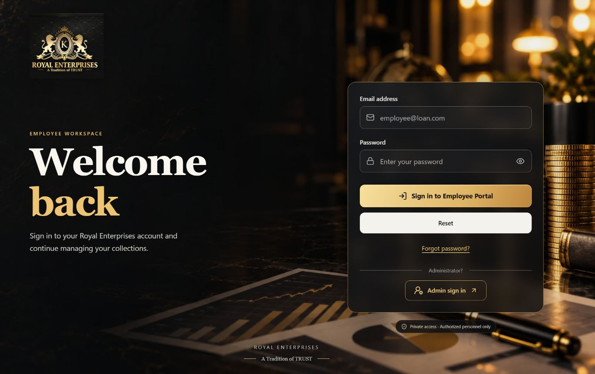
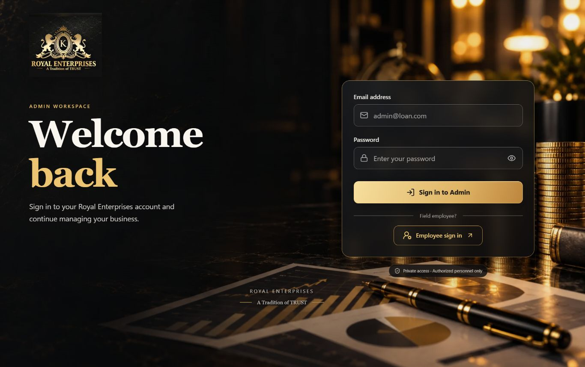
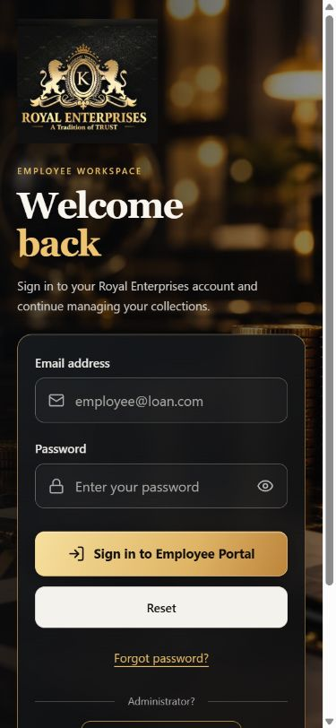
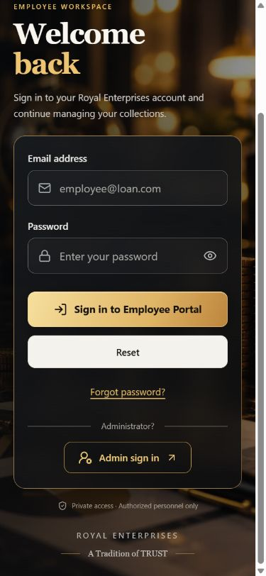
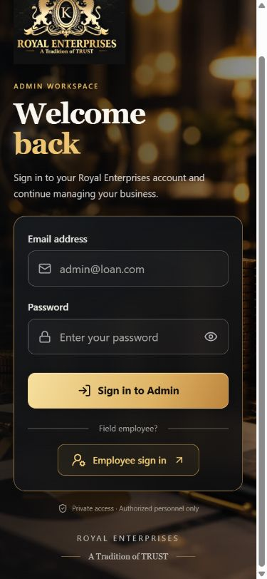

# Royal Enterprises — reference-inspired login redesign

## Implemented

Both existing Admin and Employee login pages now share a full-screen photographic financial background, original top-left company logo, dark translucent card, gold borders, gold gradient sign-in button, readable fields and matching icons. The Employee Reset and Forgot password actions and the links between portals remain available. Both forms have an accessible show/hide password control.

Phones use the reference's stacked composition; wider desktops use a welcome area beside the card. The background uses CSS `cover`, which preserves aspect ratio and crops the decorative scene as needed. The original logo uses `object-contain` and is never cropped or regenerated. Foreground contrast, focus outlines, 44–52px controls, email keyboard hints, password autocomplete and scrolling on short screens are preserved.

The background was generated with the built-in image-generation tool and encoded locally to a 102,374-byte WebP. No external image CDN, font service, package or API dependency was added. The original company artwork remains unchanged.

## Files

- `frontend/src/components/AuthShell.jsx`: shared responsive login composition.
- `frontend/src/components/auth-shell.css`: styles scoped to these two login screens.
- `frontend/src/pages/admin/Login.jsx`: presentation, icons and password visibility only.
- `frontend/src/pages/employee/Login.jsx`: presentation, icons and password visibility; Reset also hides the password again.
- `frontend/src/assets/branding/royal-financial-background.webp`: optimized background.
- `frontend/src/design-system.css`: removed the confirmed-unused prior AuthShell styling block; portal styling retained.

The existing request handlers, Axios login URL/payload, role checks, request timeout, in-flight guard, session storage, redirects, error messages and recovery route were reused. No backend source, database connection, financial calculation, payment, account or database record was changed. No real login or reset-email submission was performed during browser QA.

## Executed verification

- `npm run lint` from `frontend`: PASS.
- `node --test tests/*.test.mjs` from `frontend`: PASS, all 15 tests, including authentication/session isolation.
- `npm run build -- --outDir <separate luxury-login-build directory>` from `frontend`: PASS. Existing uncommitted production output was not replaced.
- Browser checks: both roles at 320×640, 360×800, 375×812, 390×844, 412×915, 480×900, 768×1024, 1024×768, 1366×768 and 1920×1080: PASS, 20 final checks. No document horizontal overflow, all input bounds within the viewport, loaded logos and minimum measured button height 44px. Background aspect ratio remains protected by `cover`.
- Employee dummy-field Reset: PASS; email/password cleared and password hidden again. Dummy values were never submitted.
- Password visibility: PASS for both roles.
- Empty Admin form submission: native required-email validation retained; no authentication request submitted.
- Admin ↔ Employee navigation and Employee Forgot password → Back to Employee login: PASS.
- Browser console errors in the new QA tab: none.

An initial test invocation used the repository root, where the frontend SSR test cannot resolve `/src`; rerunning from the required `frontend` working directory passed. No test was removed or bypassed. Backend tests were not rerun for this presentation-only change; no backend files were modified.

Evidence: `tmp/financial-audit/luxury-login-responsive.json` and `tmp/financial-audit/luxury-login-build.log`. Browser viewport overrides were cleared and the temporary QA tab was closed. The existing local website remains available on port 5173.

Physical Android keyboards, saved-password autofill, hardware behavior and real credential sign-in still merit a manual check on your own device. No physical-device or outbound-email delivery verification is claimed.

## Image generation record

Mode: built-in image-generation tool, new background asset. Original generated PNG retained in the tool's generated-images directory; optimized application asset saved at `C:/Users/shive/Desktop/LMS/frontend/src/assets/branding/royal-financial-background.webp`.

Final prompt:

> Create a photorealistic premium financial website background, landscape 1536x1024 composition. Reference mood: luxury Royal Enterprises black and antique gold, cinematic warm gold lighting, a dark executive desk with ascending stacks of gold coins on the right, a gold-accented pen on printed financial bar/pie charts across bottom/right, softly blurred warm lights in the upper right. Left half should be near-black charcoal with subtle atmospheric texture and ample negative space for a real website logo, headline and login form overlaid in HTML. Sophisticated realistic lighting, muted rich gold, very high quality photographic still life. No text, no lettering, no logos, no people, no UI, no login fields, no borders or watermarks. Background should remain attractive with center-right cropping on portrait phones. Generate a new background only; do not recreate any logo or bake a user interface into the image.

## Screenshots

