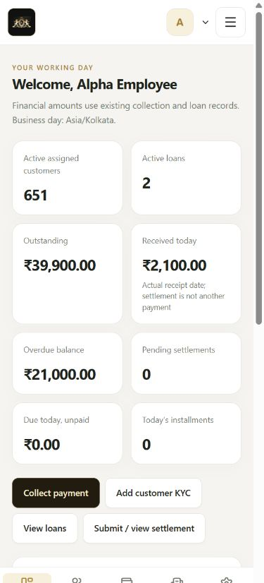
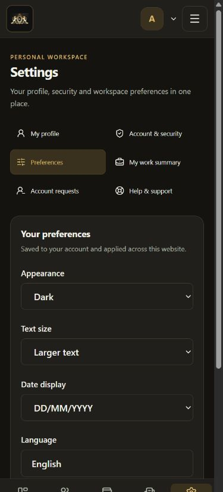
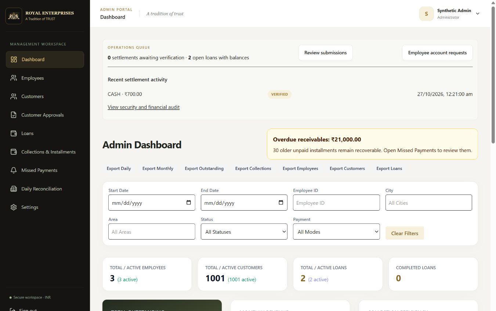
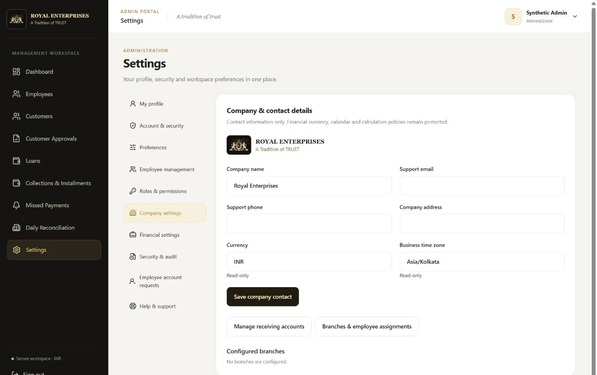
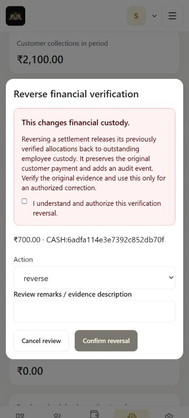
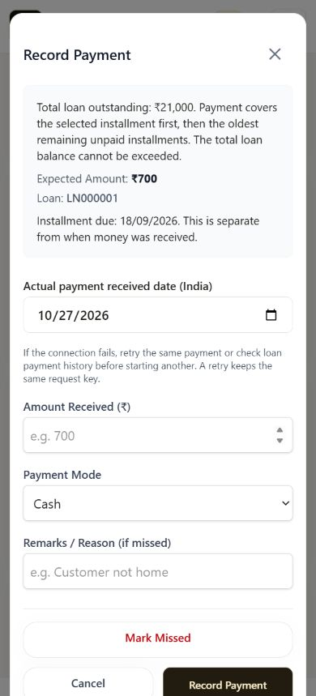
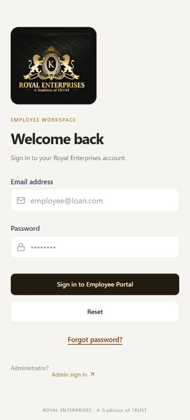
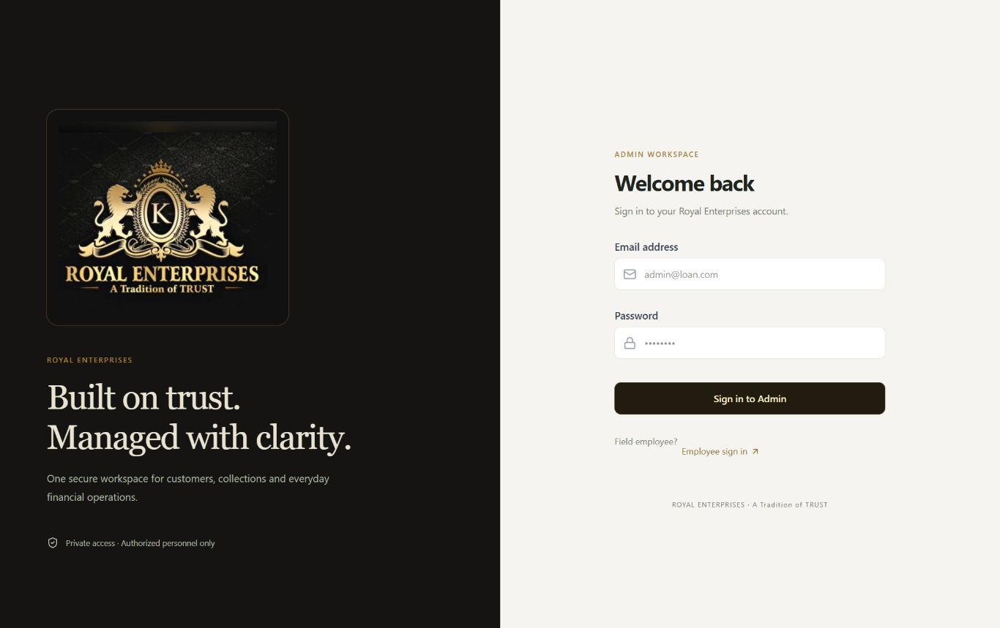
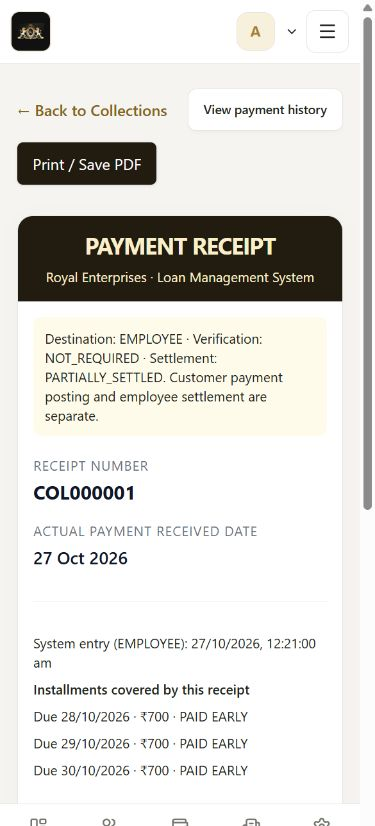

# Royal Enterprises LMS — UI and Settings acceptance report

Implemented and checked on 26 October 2026. This remains the existing React/Vite website and Node/MongoDB application. Existing Royal Enterprises artwork, routes, KYC, loan issuance, payment allocation and settlement services are retained.

## Result

| Check | Result |
| --- | --- |
| Backend regression tests | PASS — 182 tests, 21 suites |
| Frontend tests | PASS — 15 tests |
| Frontend ESLint | PASS |
| Vite production build | PASS — separate output directory preserved existing worktree/dist changes |
| Responsive browser matrix | PASS — 650 final checks, 10 widths, no document overflow |
| Isolated large customer list | PASS — 1,001 synthetic customers; server pages and search bounded |
| KYC PDF browser download | PASS — approved synthetic KYC downloaded |
| Configured application availability | PASS — backend health 200; Admin/Employee login documents 200; anonymous settings request 401 |
| Existing configured records compared to backup | PASS — no original document changed or deleted |
| Physical Android, camera hardware, keyboard and printing | NOT VERIFIED — requires a real phone/printer |

The final matrix uses actual browser inner widths of 320, 360, 375, 390, 412, 480, 768, 1024, 1366 and 1920 pixels. It covers 350 Admin and 300 Employee page/state checks, including reruns after final branding corrections, expanded recent activity, payment/reversal dialogs, recovery screens and additional dark/larger-text states. This is layout and selected interaction verification, not a claim that every destructive or financial action was submitted in the browser.

## Data protection and backup

Before adding settings schemas, the configured `loan_management` database was backed up: 22 collections, 143 documents. Each collection was saved as raw BSON, compressed and authenticated with AES-256-GCM. The recovery key and environment configuration are protected by Windows CurrentUser DPAPI. The backup is in `tmp/database-backups/20261026-pre-settings-redesign`. Keep that directory private and retain access to the same Windows account for recovery; do not publish it.

Validation recovered the protected key/configuration, decrypted every collection, decompressed the BSON, verified SHA-256 hashes and decoded documents. A restore was **not** performed against the configured database.

The final read-only raw-BSON comparison found zero changed and zero missing original records in all 22 original collections. Five audit documents had been appended (82 to 87); they were retained. Existing loans, schedules, customers, KYC documents, receipts, custody positions, accounts, numbering sequences and the verified settlement were unchanged. Three new settings collections are additive. No fixtures, resets, migrations or financial corrections were run against Atlas.

All automated financial writes and settings browser exercises used disposable MongoDB replica sets. The browser preview at ports 5010/5180 used generated secrets, isolated accounts and synthetic evidence. The configured application remains on backend 5000 and frontend 5173.

## Design and navigation

The shared design system supplies warm black, gold and white surfaces, consistent cards, forms, tables, focus states, financial status colors, loading skeletons and empty states. Existing screens inherit the common treatment; individual workflows were reused instead of rewritten.

Desktop retains its sidebar. Mobile has five daily-work destinations: Dashboard, Customers, Collections, Settlement and Settings. Less-used screens remain in a focus-managed hamburger drawer. The compact header uses the original emblem, with account/profile navigation and reduced duplicated branding. Inputs, cards, wrapped controls, dialog scrolling, bottom spacing and safe areas accommodate small screens. Keyboard visibility uses the visual viewport; physical Android behavior still needs checking.

KYC section navigation now wraps into readable layouts instead of overlapping or requiring sideways navigation. Switching sections retained a synthetic unsaved name in browser verification. Private uploads, approval revisions, PDF actions and all existing sections remain accessible.

Public pattern references used for structure, without copying product code or proprietary artwork:

- [Material navigation guidance](https://m2.material.io/design/navigation/) — a small set of frequent mobile destinations plus secondary navigation.
- [Mifos collection workflow](https://docs.mifos.org/mifosx/user-manual/for-operational-users-mifos-x-web-app/accounts-and-transactions/loan-accounts/using-collection-sheet-or-other-payment-types-for-making-payments) — staff/date context and clear separation of clients, repayment details and payment references.

## Employee Settings

Open **Employee → Settings**, or the account menu → **My profile & Settings**.

- **My profile:** private photo upload/preview/replace/remove; camera/gallery inputs; name, email, phone, employee code, branch, city/area, joining date and status. Address is directly editable. Protected identity/work fields use an Admin-reviewed request.
- **Account & security:** current-password validation, confirmation, show/hide control, password rules, safe account activity, device logout and reauthenticated session revocation. Revoking all sessions includes the current session and requires signing in again.
- **Preferences:** light/dark/device appearance, larger text, date-only display format and optional dashboard activity. Preferences persist per account. Required payment messages and financial warnings remain visible. English is available; Hindi is explicitly unavailable until full translation exists.
- **My work summary:** assigned active customers, open loans, outstanding, receipts received today, overdue dues, pending settlements, recent settlement states and quick links. Dashboard upcoming installments show real due dates and advance-payment labels.
- **Account requests:** password-confirmed profile-change or deactivation request, mandatory reason, status/history and cancellation while pending. Employees cannot delete accounts or financial records.
- **Help:** workflow explanations, version and configured Admin contact options. Missing contact configuration is stated clearly.

Profile photos accept JPEG/PNG, at most 2 MB and 16 megapixels. Type, signature and image decoding are validated on the server; bytes are encrypted using the existing persistent KYC encryption facility. Images are served through authenticated, no-store endpoints, never public document URLs.

Passwords require 12–64 characters, upper/lowercase, a number and a symbol, a matching confirmation and a different value from the current password. Bcrypt's byte limit is validated. Password changes revoke prior JWTs for both roles. Incorrect password reauthentication returns a validation error without erasing a valid portal session.

## Admin Settings and setup

Open **Admin → Settings**.

1. **Company settings:** enter the real company support email/phone/address, then save contact details. Currency INR and business time zone Asia/Kolkata are read-only. Branch information comes from existing records. No new holiday, interest or repayment policy control was introduced.
2. **Manage receiving accounts:** opens **Admin → Daily Reconciliation → Receiving accounts** directly via `?accounts=1`. Use the existing authorized workflow to enter verified destinations. No bank or UPI destination was invented.
3. **Employee management:** opens the existing employee directory with photos, code, phone, branch, status, search, filters and pagination. Detail pages now show the real employee profile, work summary, dependencies and portfolio links. Existing edit/status/temporary-password workflows are preserved, with confirmations for sensitive actions.
4. **Employee account requests:** review requester, previous/proposed fields, reason, timestamp and dependencies. Approve/reject with remarks. Profile approval checks for stale records and duplicate email/phone, then revokes the employee's old sessions.
5. **Security & audit:** search safe action metadata, filter actor role and paginate events. The personal Account & Security view shows only the current account's security events; the Admin audit section retains authorized access to all event categories.
6. **Financial settings / Roles & permissions:** inspect existing policy descriptions and permission boundaries. These screens do not expand roles or change financial rules.

Deactivation is reversible and retains employee attribution. It is blocked by active/defaulted loans with a positive balance, outstanding employee custody, unresolved submitted/disputed settlements or assigned customers. Resolve those through existing authorized workflows before retrying. Direct Admin status changes use the same dependency guard. Admin employment edits and status changes revoke previous sessions, so reactivation cannot revive an old token. The existing ACTIVE/INACTIVE status model is preserved.

## Settlement safety

Verified settlements now offer **Reverse verification**, with a warning describing the effect on employee custody. Confirmation requires explicit acknowledgement and a reason of at least five characters. The existing server authorization, version checks, ledger transaction and duplicate-submission guard remain in place.

Owner, owner submission, entry timestamp, actual handover time, reviewer and review time are displayed separately. A settlement remains distinct from a customer receipt; verification never adds another customer payment. Browser QA opened and cancelled the reversal dialog. Neither the real nor the synthetic verified settlement was reversed through the UI.

## Performance and financial compatibility

- Existing server-paginated customer portfolios remain available. Employee lists use bounded pages, whitelisted sorting, escaped prefix search, status/branch filters and batched photo metadata.
- Collections fetch bounded server pages, with debounced customer/loan search and a full-filtered-list remaining total. Legacy API consumers without pagination keep their array response.
- Loan list schedule lookups are batched instead of one query per loan.
- Dashboard totals use read-only database aggregates with shared paise conversion and IST business-day boundaries. Regression tests compare results against the existing financial-report read model. Maturity, allocation, principal, interest and custody write logic are unchanged.
- An additive receipt-date/loan index supports dashboard date queries. New settings models have account and pending-request indexes.
- Routes remain lazy loaded; private photo object URLs are released and only visible employee images are fetched. No remote fonts or new chart/PDF libraries were added.

Disposable local smoke measurements with 1,001 customers and two loans returned customer pages of 25 rows in 72–84 ms (about 13 KB), an installment page of 20 rows in 48 ms, a dashboard read in 23 ms and three employees in 13 ms. These are single-machine smoke measurements, not a production load test or slow-network guarantee. Growing historical payment/schedule volumes still warrant deployment-specific query-plan and load testing.

## Files for this change

| Area | Main created/updated files |
| --- | --- |
| Shared UI | `frontend/src/design-system.css`, `components/ui/Primitives.jsx`, `components/AuthShell.jsx`, `components/EmployeeAvatar.jsx` |
| Navigation | `layouts/PortalShell.jsx`, `layouts/AdminLayout.jsx`, `layouts/EmployeeLayout.jsx`, `App.jsx`, `main.jsx` |
| Settings / settlement | `pages/shared/Settings.jsx`, `pages/shared/DailySettlement.jsx` |
| Employee screens | `pages/employee/Dashboard.jsx`, `Loans.jsx`, `KycList.jsx`, `TodayCollections.jsx`, `AddLoan.jsx`, `CustomerDetails.jsx`, `Receipt.jsx`, `Login.jsx`; shared `pages/shared/CustomerKyc.jsx` |
| Admin screens | `pages/admin/Dashboard.jsx`, `EmployeeList.jsx`, `EmployeeDetails.jsx`, `CustomerLeads.jsx`, `Login.jsx`; `components/EmployeeTable.jsx` |
| Shared data / dates | `components/portfolios/PortfolioUi.jsx`, `components/collections/RecordPaymentModal.jsx`, `utils/businessDate.js` |
| Settings backend | `models/AccountSettings.js`, `AccountRequest.js`, `CompanySettings.js`; `routes/settings.routes.js`, `services/settings.service.js`, `app.js` |
| Existing auth / models | `models/Admin.js`, `Employee.js`, `Collection.js`; `middlewares/auth.middleware.js`, `utils/jwt.js`, `repositories/auth.repository.js` |
| Read performance / management | `repositories/dashboardAggregates.js`, `dashboard.repository.js`, `employee.repository.js`, `collection.repository.js`; `services/employee.service.js`, `loan.service.js`, `collection.service.js`; `controllers/employee.controller.js` |
| Regression tests | `backend/tests/integration/settings.integration.test.js`, `datedPayments.integration.test.js`, `financialWorkflow.integration.test.js`, `api.integration.test.js`; `backend/tests/unit/middleware.test.js`; `frontend/tests/portfolios.test.mjs` |

Other dirty/untracked files already existed and were preserved. This table identifies this implementation's main files, not every file currently shown by Git.

## New settings APIs

All routes below are under `/api/v1/settings`, authenticated and no-store. Service checks enforce role and ownership independently of the UI.

| Method | Path | Purpose |
| --- | --- | --- |
| GET | `/me` | Safe own profile, preferences and company contact |
| PATCH | `/profile`, `/preferences` | Whitelisted own changes |
| POST | `/password`, `/sessions/revoke` | Reauthenticated password/session operations |
| GET / POST / DELETE | `/photo` | Private own image |
| GET | `/employees/:id/photo`, `/employees/:id/summary`, `/employees/:id/dependencies` | Admin-only employee views |
| GET | `/work`, `/activity` | Scoped work summary and safe paginated audit |
| GET / POST | `/requests` | Scoped request list / own employee request |
| POST | `/requests/:id/cancel` | Own pending cancellation |
| POST | `/requests/:id/review` | Admin transactional review |
| PATCH | `/company` | Admin contact-only update |

Sensitive password/photo/request operations are rate limited. No endpoint deletes accounts or historical data. Admin JWT version checks are additive: legacy tokens without a version map to zero, until a sensitive account action revokes that version.

## Test evidence and issues fixed

Executed final commands:

```text
backend: npm test -- --runInBand
frontend: npm run lint
frontend: node --test tests/*.test.mjs
frontend: npm run build -- --outDir <separate redesign-final-build directory>
```

The test MongoDB binary was the existing cached mongodb-memory-server executable. Full backend coverage thresholds passed; coverage is for the repository's configured modules, not a claim of complete application coverage.

Regression coverage includes private photos, malformed/oversized uploads, field whitelists, cross-employee denial, stale/duplicate requests, profile approvals, request cancellation/rejection, password hashing and token revocation, deactivation dependencies, preserved custody/settlement documents, company financial-policy rejection, pagination totals, dated/advance payments and aggregate/report consistency. Existing KYC, settlement, financial, authentication and export tests also passed.

Failures found during implementation were corrected and rerun: oversized photo uploads initially returned 500 instead of 413; inactive Admin status compatibility required 403; nested settings-list metadata hid request rows; chart resizing could temporarily overflow; and the personal Admin security activity view initially included broader audit events. Final backend/frontend checks pass.

Browser interactions covered independent portal logins, mobile drawer navigation, settings tabs, address save, image selection/preview/upload, preference persistence, Admin approval of a synthetic profile request and subsequent Employee reauthentication, KYC section value retention, PDF download, payment dialog open/cancel and reversal dialog open/cancel. Credential-changing submissions were exercised through isolated API tests, not through browser UI.

Detailed evidence remains local under `tmp/financial-audit`: `redesign-backend-final.log`, `redesign-frontend-tests.log`, `redesign-frontend-build.log`, `redesign-responsive-results.json`, `redesign-performance.json` and `redesign-data-preservation.json`. Early stale-fixture/heading locator errors and measurements from a nonselected browser tab were rerun and excluded from final results.

## Remaining manual acceptance checks

1. On an actual Android phone, open Employee login and use your own account. Check scrolling, hamburger menu, bottom navigation, numeric/date keyboards and keyboard closing.
2. In Settings, preview a real camera/gallery photo; confirm save, replace and remove. Keep the existing encryption key persistent. Hardware camera permission was not granted during automation.
3. Test dark/device appearance and larger text, then reopen the browser. Check your preferred date format; existing PDF/legacy timestamp formats are retained.
4. With approved disposable business data of your choosing, check issuance, advance/backdated payment receipts and submission of available custody. Do not reverse the existing verified settlement merely to test the UI.
5. Check Admin requests and dependency messages. A protected profile approval or password change deliberately requires the employee to sign in again.
6. Preview/download and print a receipt and KYC on your actual phone/printer. Download succeeded in automation; operating-system print output and physical printing were not verified.
7. Set real support contacts in Admin Company settings. Email/password-reset delivery still depends on the pre-existing SMTP configuration; this task did not configure or verify outbound email.

No unresolved automated test or build failures remain. Physical-device behavior, printing, outbound email delivery and production-scale historical-data performance remain acceptance checks.

## Screenshots (synthetic data only)


















